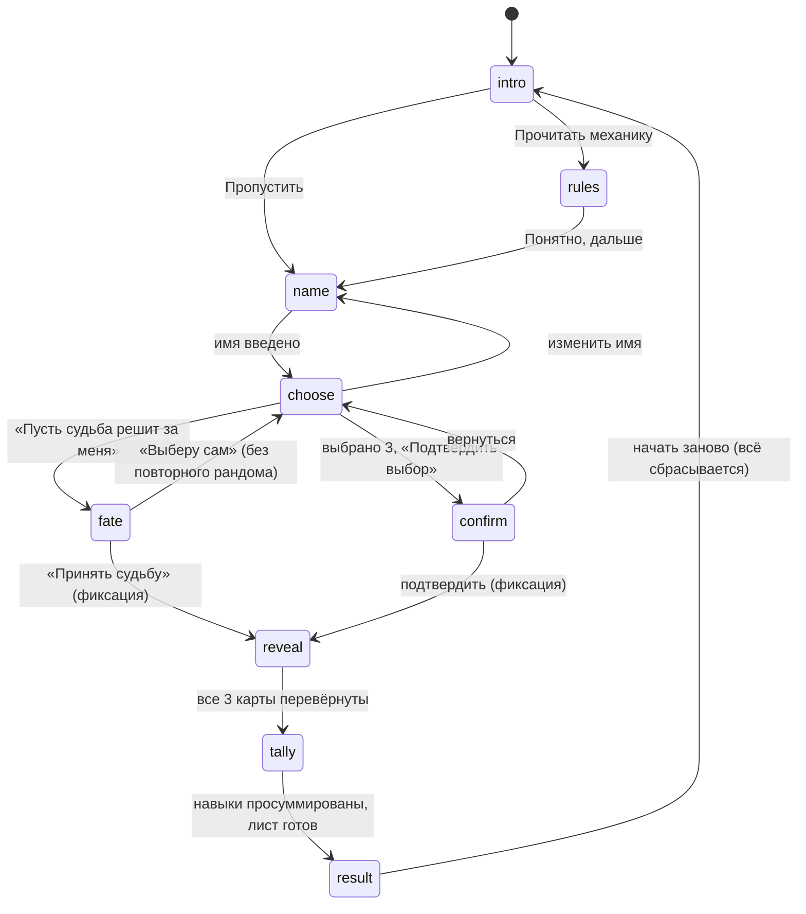

# RollSet — архитектура

Статический сайт без сборки: HTML + CSS + ES-модули. Публикуется на GitHub Pages как есть.

## Принципы

1. **Данные отдельно от логики.** Всё, что относится к игре (карты, навыки, модификаторы, текст механики, координаты на листе, шрифты), лежит в `js/data/`. Логика в `js/core/` ничего не знает о конкретных картах.
2. **Ядро без DOM.** Всё в `js/core/` — чистые функции и конечный автомат. Они запускаются в Node и покрыты тестами.
3. **Один источник правды — состояние.** Интерфейс только отображает `state` и отправляет действия. Нельзя «обойти» шаги: например, после подтверждения редьюсер игнорирует любые попытки сменить карты.
4. **Нет хранилищ.** Ни `localStorage`, ни `sessionStorage`, ни `IndexedDB`, ни cookies. Состояние живёт в памяти страницы, перезагрузка сбрасывает всё.
5. **Нет выдуманных игровых данных.** Карты, модификаторы, текст механики и координаты на листе — тестовые заглушки, помеченные в коде и в интерфейсе.
6. **Заменяемые ассеты.** Картинки и шрифты берутся из `Assets/`. Если файла нет, интерфейс показывает временный макет и не падает.

## Структура файлов

```
rollset/
├── index.html                  основное приложение
├── calibrate.html              инструмент подгонки полей на листе
├── css/
│   ├── base.css                токены (цвета, шрифты, размеры), сброс, каркас страницы
│   ├── components.css          кнопки, поля, диалоги, таблица навыков, результат
│   ├── cards.css               плитки карт, переворот, заглушки
│   ├── animations.css          keyframes и prefers-reduced-motion
│   └── calibrate.css
├── js/
│   ├── main.js                 точка входа: сборка зависимостей
│   ├── calibrate.js            логика страницы калибровки
│   ├── config.js               константы: 3 карты, пути, тайминги, режим «судьбы»
│   ├── data/                   ← ВСЁ, ЧТО МЕНЯЕТСЯ БЕЗ ПРАВКИ ЛОГИКИ
│   │   ├── skills.js           9 навыков (id + название)
│   │   ├── cards.js            27 карт: id, номер, название, модификаторы   [ТЕСТ]
│   │   ├── mechanics.js        текст «описания механики»                    [ТЕСТ]
│   │   ├── sheet-layout.js     размеры листа и координаты полей             [ТЕСТ]
│   │   └── fonts.js            список пользовательских шрифтов
│   ├── core/                   чистая логика, без DOM
│   │   ├── flow.js             редьюсер конечного автомата
│   │   ├── store.js            мини-стор (getState / dispatch / subscribe)
│   │   ├── controller.js       команды: выбрать, судьба, подтвердить, …
│   │   ├── rng.js              криптослучайность и выбор уникальных
│   │   ├── skills.js           суммирование модификаторов, форматирование
│   │   ├── validate.js         проверка данных карт и раскладки
│   │   ├── paths.js            пути к картинкам
│   │   ├── filename.js         имя файла для скачивания (с кириллицей)
│   │   ├── text-fit.js         подбор размера шрифта и перенос строк
│   │   ├── pdf.js              запись PDF A4 без библиотек
│   │   └── png.js              чтение размеров PNG (для проверки ассетов)
│   ├── render/                 всё, что рисует на canvas
│   │   ├── assets.js           загрузка картинок (без падения при 404)
│   │   ├── fonts.js            подключение шрифтов через FontFace
│   │   ├── sheet-renderer.js   наложение имени, архетипов и навыков
│   │   ├── placeholder-sheet.js временный макет, если PNG листа не найден
│   │   ├── sheet-service.js    сборка холста листа
│   │   └── export.js           скачивание PNG и PDF
│   └── ui/                     DOM и анимации
│       ├── dom.js, strings.js, card-view.js, app-view.js
│       └── views/ choose-view.js, stage-view.js, dialogs.js
├── Assets/
│   ├── Backs/    01.png … 27.png   рубашки (у каждой карты своя)
│   ├── Faces/    01.png … 27.png   лицевые стороны
│   ├── Sheet/    character-sheet.png   лист 2480×3508
│   └── Fonts/    файлы шрифтов (woff2/ttf/otf)
├── tests/                      node --test
├── tools/check-assets.mjs      проверка, что все файлы на месте и лист нужного размера
└── docs/ARCHITECTURE.md
```

## Поток данных

```
 data/*  ──►  validate ──► (ошибки данных → экран с причинами)
   │
   ▼
 main.js ──► store(flow reducer) ◄── controller ◄── клики (ui/*)
                 │
                 └──► ui views: sync(state)  →  DOM
                          │
                          └─ после подтверждения ─► stage-view
                                 1. переворот карт по одной
                                 2. сумма модификаторов (core/skills.js)
                                 3. sheet-service → canvas 2480×3508
                                 4. export.js → PNG / PDF A4
```

## Конечный автомат



Фиксация — единственная точка, после которой `locked = true`. В фазах `reveal`, `tally`, `result` редьюсер не принимает действий выбора.

## Решения, которые стоит проверить

| Вопрос | Как сделано | Где поменять |
|---|---|---|
| Что видно у закрытых карт | рубашка + название; лицо и модификаторы в DOM не попадают до фиксации | `ui/views/choose-view.js` |
| «Судьба» после отказа | один бросок за сеанс; «Выберу сам» возвращает прежний ручной выбор, повторного броска нет | `config.js → fate` |
| Подтверждение ручного выбора | отдельный диалог «изменить будет нельзя» | `ui/views/dialogs.js` |
| Минус на листе | обычный дефис `-` (есть в любом шрифте) | `data/sheet-layout.js → SHEET_STYLE.minus` |
| PDF | A4, лист на всю страницу, картинка JPEG 95 % (PNG — без потерь) | `config.js → pdf` |
